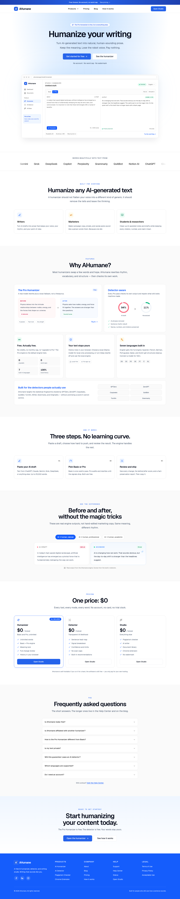
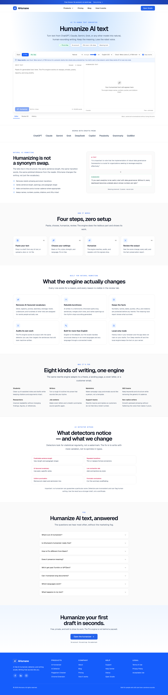
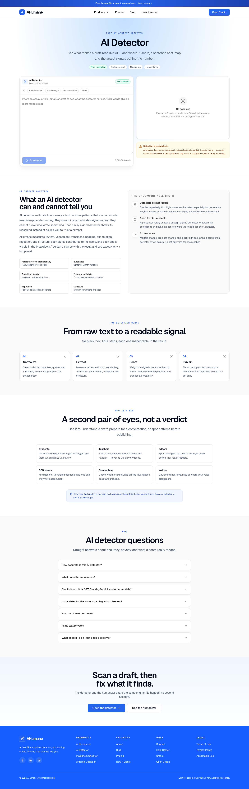
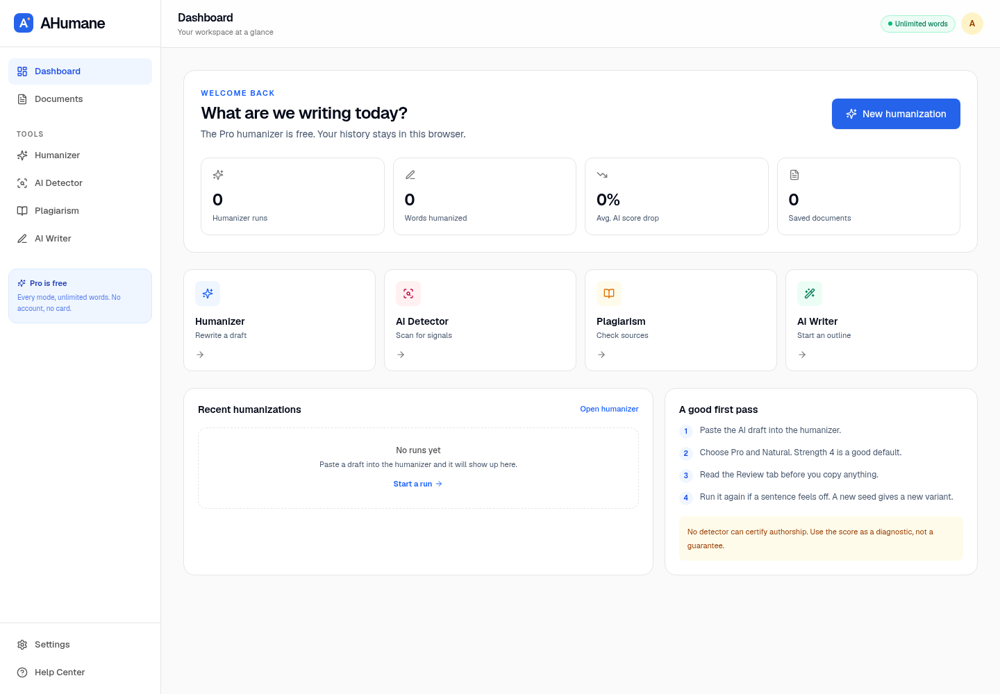

# AHumane
https://ahumane.netlify.app/
A free, self-hosted AI humanizer and writing studio. Rewrite AI-assisted drafts into natural prose, check them with a transparent detector, scan for copied passages, and keep every fact in place.

AHumane is an independent project. It is not affiliated with, endorsed by, or built from any other humanizer's code, prompts, or assets.



## What it does

- **Pro Humanizer** — model-first semantic rewriting. A real language model rewrites the draft, a second editorial pass revises it, and every protected fact is checked before the result is accepted. A local four-pass engine runs when no model is available.
- **Local AI** — Ollama, Unsloth fine-tunes exported to GGUF, vLLM, or any OpenAI-compatible endpoint. Pick the provider and model in the studio.
- **AI Detector** — a transparent heuristic with a score, sentence heat-map, signal breakdown, confidence, and explicit limits. It is not GPTZero, Sapling, Copyleaks, or Turnitin.
- **Plagiarism Checker** — exact 8-word shingle matching against a local public-domain corpus and optional English Wikipedia search.
- **AI Writer** — a template-based outline and draft builder.
- **Documents** — browser-local drafts and humanization history.
- **Chrome extension** — send selected text from any page to the studio.
- **Marketing site** — home, humanizer, detector, plagiarism, Chrome, pricing, blog, about, how-it-works, help, status, login, terms, privacy.

Everything is free: no account, no paid tier, no watermark. The software is self-hosted, so hosting is the only cost.

## Screenshots

| Page | Preview |
|---|---|
| Home |  |
| Humanizer |  |
| Detector |  |
| Studio |  |

## Quick start

Requirements: Node.js 22+, pnpm 10+.

```bash
pnpm install
pnpm dev
```

Open <http://localhost:3210>.

Production:

```bash
pnpm build
pnpm start
```

## Docker

```bash
docker compose up -d --build
docker compose exec ollama ollama pull qwen2.5:7b-instruct
```

Open <http://localhost:3210>. The compose file runs the app and Ollama with local-only mode enabled.

## Local AI

### Ollama

1. Install [Ollama](https://ollama.com/) and pull a model:

   ```bash
   ollama pull qwen2.5:7b-instruct
   # or a smaller/faster CPU model:
   ollama pull dolphin3-qwen2.5:1.5b
   ```

2. Start the app. In the studio, open **Settings → Deep rewrite model** and choose the Ollama model. The same picker is in the humanizer toolbar when Deep rewrite is enabled.

3. For local-only mode, set:

   ```bash
   AHUMANE_PREFER_LOCAL=1
   # optional
   OLLAMA_BASE_URL=http://127.0.0.1:11434
   OLLAMA_MODEL=qwen2.5:7b-instruct
   ```

Ollama models on a CPU can be slow. A 1.5B–4B model is usually the best experience on a laptop; a 7B–14B model is better if you can wait. The UI shows the selected model and the request timeout is 15 minutes.

### Unsloth fine-tune

Unsloth is a fast LoRA/QLoRA training layer. A typical local workflow:

1. Fine-tune a small instruct model on your own writing pairs.
2. Export a merged model or a GGUF quantisation.
3. Import the GGUF into Ollama with a `Modelfile`.
4. Select the new Ollama model in AHumane.

A complete walkthrough and example training script live in [`docs/local-ai.md`](docs/local-ai.md) and [`scripts/unsloth/`](scripts/unsloth/).

### vLLM / OpenAI-compatible

If you serve a model with vLLM, llama.cpp server, LM Studio, or another OpenAI-compatible server:

```bash
LLM_BASE_URL=http://127.0.0.1:8000/v1
LLM_MODEL=your-model-name
# optional
LLM_API_KEY=...
```

The provider appears in the model picker as **Custom / Unsloth (vLLM)**.

### Hosted fallback

Deep rewrite also works with a free public model endpoint (Llama 3.3 70B through OVHcloud). It is enabled by default when reachable and is disclosed in the UI. To disable it and keep everything local:

```bash
AHUMANE_DISABLE_CLOUD=1
```

## Model selection

The studio stores the selected provider/model in browser settings and sends it with each request:

- `auto` — best available provider (cloud endpoint, then custom, then local if preferred)
- `ovh` — the free public cloud endpoint
- `ollama` — a model installed in Ollama
- `openai-compatible` — `LLM_BASE_URL` / `LLM_MODEL`

The server validates the selection and falls back to the local engine if the model is unavailable or loses a protected fact.

## Configuration

| Variable | Default | Purpose |
|---|---|---|
| `AHUMANE_DISABLE_CLOUD` | unset | Set to `1` to disable the public cloud endpoint |
| `AHUMANE_PREFER_LOCAL` | unset | Set to `1` to prefer Ollama over cloud |
| `OVH_BASE_URL` | `https://oai.endpoints.kepler.ai.cloud.ovh.net` | Cloud endpoint base |
| `OVH_MODEL` | `Meta-Llama-3_3-70B-Instruct` | Cloud model |
| `OLLAMA_BASE_URL` | `http://127.0.0.1:11434` | Ollama API |
| `OLLAMA_MODEL` | first installed | Default Ollama model |
| `OLLAMA_TIMEOUT_MS` | `900000` | Local model request timeout (15 minutes) |
| `LLM_BASE_URL` | unset | OpenAI-compatible endpoint |
| `LLM_MODEL` | unset | OpenAI-compatible model |
| `LLM_API_KEY` | unset | Optional bearer token |

## Architecture

```
app/                  routes (marketing, studio, API)
components/           marketing, studio, UI primitives, brand
lib/humanizer/        normalize, protect, segment, lexicon, rules, pipeline, model, prompt
lib/detector/         feature extraction and scoring
lib/plagiarism/       local corpus and Wikipedia comparison
lib/llm/              provider adapters (OVH, Ollama, OpenAI-compatible)
lib/content/          site copy, FAQs, articles
lib/studio/           browser storage, writer templates
tests/                unit fixtures and tests
docs/                 research, evaluation, local AI, external detector tests
scripts/              evaluation, screenshots, extension packaging, Unsloth examples
public/extension/     unpacked Chrome extension
```

### Fact protection

Before any rewrite, the engine replaces URLs, emails, code, numbers, dates, currencies, percentages, citations, quoted spans, and multi-word names with private-use tokens. The model never sees the original values; after the rewrite the tokens are restored and checked. If a value is missing, the rewrite is rejected and the local engine runs. A second pass is kept only when it also preserves every token.

### Why the local engine exists

Not every machine can run a model, and not every draft should leave the machine. The local engine is a four-pass deterministic pipeline: lexical cleanup, rhythm/variety work, paragraph shaping, and validation. It is fast and private, but it is not a substitute for a real model rewrite. Pro uses the model when available.

## Testing

```bash
pnpm lint
pnpm typecheck
pnpm test
pnpm test:e2e      # server must be running on 127.0.0.1:3210
pnpm eval:humanizer
```

The unit suite covers the tokenizer, protection round-trips, humanizer determinism, fact retention, detector separation, and plagiarism matching. Playwright covers the marketing pages, humanizer, detector, documents, login, mobile menu, and axe accessibility checks.

### External detector tests

We tested the public detector pages directly. The results are deliberately unflattering:

- ZeroGPT scored a human public-domain passage at **78.4% AI** and a leading free commercial humanizer's output at **100%**.
- Sapling scored long human essays at **0%**, but every LLM output tested at **99.9–100%**.
- GPTZero, Copyleaks, and Originality.ai required accounts, credits, or blocked headless access.

Full method and table: [`docs/external-detector-tests.md`](docs/external-detector-tests.md).

**AHumane does not guarantee that any text will pass any detector.** Detectors are inconsistent, frequently wrong, and not an authorship test. The humanizer is a writing tool, not a certificate.

## Privacy

- History and documents stay in `localStorage`.
- The reference server does not log request bodies.
- Deep rewrite sends drafts to the selected model endpoint. The free public endpoint is third-party and may retain prompts under its own terms.
- Local-only mode keeps the text on your server.
- The plagiarism checker sends only short search shingles to Wikipedia.

See [`/privacy`](app/(marketing)/privacy/page.tsx) for the full policy.

## Limits

- Deep rewrite: 100–2,400 words per run because of latency and context limits.
- Local engine: up to 25,000 words per request.
- The detector is a heuristic, not a trained commercial classifier.
- The plagiarism checker covers a public-domain corpus and Wikipedia, not the whole web.
- The login page is a local demo, not real authentication.
- The Chrome extension is an unpacked build, not a Web Store listing.

## License

MIT. See [LICENSE](LICENSE). Third-party names (ChatGPT, Claude, Gemini, Ollama, Unsloth, vLLM, GPTZero, Sapling, Copyleaks, Originality.ai, Turnitin, QuillBot, Wikipedia, etc.) are trademarks of their respective owners and are used only for identification.
=======
AHumane, local AI detector/humanizer website!
